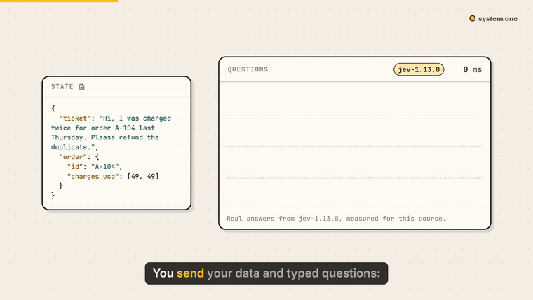

<p align="center"><a href="https://learn-system-one.pages.dev"></a></p>

<h1 align="center">System One</h1>
<p align="center"><b>A free, animated course on decision models: typed judgments, calibrated probabilities, and software that decides.</b><br>
TypeSafe Jev · OpenAI Decisions API · Cloudflare Clef · AWS Strands Decider.<br>
22 short lessons · ~82 minutes · 199 sources · 14,318 API calls we ran ourselves · every claim linked to its source.</p>

<p align="center">
<a href="https://learn-system-one.pages.dev/lessons/software-needs-decisions/"><b>▶ Start lesson 1</b></a> ·
<a href="#lessons">All lessons</a> ·
<a href="#your-agent-can-take-this-course-too">For your agent</a> ·
<a href="https://learn-system-one.pages.dev/measured/">What we measured</a> ·
<a href="https://learn-system-one.pages.dev/llms.txt">llms.txt</a>
</p>

---

In September 2026 a new kind of model appeared: **System One models**, or decision models. They don't write. They read your data (the *state*) and answer typed questions with probabilities: a yes or no (**Noul**), one of your options (**Choice**), or a position on your scale (**Score**), in a single forward pass, in a fraction of a second, for a fraction of a cent. TypeSafe's Jev came first; OpenAI, Cloudflare and AWS followed within three weeks.

This course teaches you to build with them well: what to ask, which numbers to trust, how to compose small judgments in code, how to evaluate on your own data, and where they break. It's built from the vendors' docs and cookbooks, 58 talks and podcasts, 18 papers, independent tests, and our own measurements. Not affiliated with or endorsed by TypeSafe, OpenAI, Cloudflare or AWS.

## What you'll learn

- **The idea**: why software needs decisions, System One vs System Two, how a decision model works, and the four you can use today
- **Asking good questions**: Noul, Choice and Score, and the state they read
- **Probabilities you can act on**: calibration, confidence, thresholds from costs, and how much you can safely automate
- **Composing judgments**: decomposition, asking everything at once, routing and cascades, select don't generate, verification and guardrails
- **Real systems**: decision models inside agents, and judgments as data
- **Shipping it**: the jagged edges, evaluating on your own data, deciding responsibly, and a capstone triage pipeline you can run

Each lesson is a 3–5 minute animated video, a full transcript, a quiz, a "try it with your agent" prompt, and cited sources.

## Measured for this course

Vendor numbers are upper bounds, so we ran our own tests ([details](https://learn-system-one.pages.dev/measured/), [code](experiments/)). On BANKING77 (3,080 real banking messages, 77 intents), Jev 1.13 was 80.1% right overall and 96.3% right on the 50% of answers it gave at 0.99 or more, at about $0.07 per thousand decisions. Thirteen questions in one request took 0.27 s and 1,828 tokens; as thirteen separate requests, 3.3 s and 18,940 tokens.

## Your agent can take this course too

The course ships as **agent skills**:

```bash
npx skills add Haple/system-one
```

In Claude Code you can also add it as a plugin marketplace:

```
/plugin marketplace add Haple/system-one
/plugin install system-one@system-one
```

| Skill | What it does |
|---|---|
| `decision-models` | Practices your agent applies whenever it writes a decision-model call: typed questions, one request, thresholds from costs, select don't generate, code for arithmetic, evaluation |
| `system-one-tutor` | Teaches you the course interactively. Try: `teach me lesson 1 of system one` |
| `decision-audit` | Finds prompt-and-parse LLM calls that should be decisions, and reviews existing integrations. Try: `audit our LLM decisions` |

Or point any agent at [`llms.txt`](https://learn-system-one.pages.dev/llms.txt) / [`llms-full.txt`](https://learn-system-one.pages.dev/llms-full.txt).

<a id="lessons"></a>
## Lessons

### Module 1 · The idea

Why software needs decisions, and what a decision model is.

| # | Lesson | Watch | Read | Length |
|---|---|---|---|---|
| 01 | **Software needs decisions, not essays** | [▶ watch](https://learn-system-one.pages.dev/lessons/software-needs-decisions/) | [markdown](lessons/01-software-needs-decisions.md) | 4 min |
| 02 | **System One and System Two** | [▶ watch](https://learn-system-one.pages.dev/lessons/system-one-and-system-two/) | [markdown](lessons/02-system-one-and-system-two.md) | 3 min |
| 03 | **How a decision model works** | [▶ watch](https://learn-system-one.pages.dev/lessons/how-decision-models-work/) | [markdown](lessons/03-how-decision-models-work.md) | 4 min |
| 04 | **Jev, Decisions, Clef, Strands: the landscape** | [▶ watch](https://learn-system-one.pages.dev/lessons/decision-models-compared/) | [markdown](lessons/04-decision-models-compared.md) | 4 min |

### Module 2 · Asking good questions

The three primitives, and the state they read.

| # | Lesson | Watch | Read | Length |
|---|---|---|---|---|
| 05 | **Noul: the probability of yes** | [▶ watch](https://learn-system-one.pages.dev/lessons/noul-yes-no-questions/) | [markdown](lessons/05-noul-yes-no-questions.md) | 4 min |
| 06 | **Choice: one answer from a set** | [▶ watch](https://learn-system-one.pages.dev/lessons/choice-questions/) | [markdown](lessons/06-choice-questions.md) | 4 min |
| 07 | **Score: a position on a scale you describe** | [▶ watch](https://learn-system-one.pages.dev/lessons/score-questions/) | [markdown](lessons/07-score-questions.md) | 4 min |
| 08 | **State: give it what it needs** | [▶ watch](https://learn-system-one.pages.dev/lessons/designing-state/) | [markdown](lessons/08-designing-state.md) | 4 min |

### Module 3 · Probabilities you can act on

Calibration, confidence and thresholds.

| # | Lesson | Watch | Read | Length |
|---|---|---|---|---|
| 09 | **Calibration: does 0.9 mean 90%?** | [▶ watch](https://learn-system-one.pages.dev/lessons/calibration/) | [markdown](lessons/09-calibration.md) | 4 min |
| 10 | **Confidence and thresholds** | [▶ watch](https://learn-system-one.pages.dev/lessons/confidence-thresholds/) | [markdown](lessons/10-confidence-thresholds.md) | 4 min |
| 11 | **Automate the sure ones** | [▶ watch](https://learn-system-one.pages.dev/lessons/selective-automation/) | [markdown](lessons/11-selective-automation.md) | 4 min |

### Module 4 · Composing judgments

Small questions, combined in code.

| # | Lesson | Watch | Read | Length |
|---|---|---|---|---|
| 12 | **Decompose: many small questions** | [▶ watch](https://learn-system-one.pages.dev/lessons/decompose-judgments/) | [markdown](lessons/12-decompose-judgments.md) | 4 min |
| 13 | **Ask everything at once** | [▶ watch](https://learn-system-one.pages.dev/lessons/speculative-fan-out/) | [markdown](lessons/13-speculative-fan-out.md) | 3 min |
| 14 | **Route and cascade** | [▶ watch](https://learn-system-one.pages.dev/lessons/routing-and-cascades/) | [markdown](lessons/14-routing-and-cascades.md) | 4 min |
| 15 | **Select, don't generate** | [▶ watch](https://learn-system-one.pages.dev/lessons/select-dont-generate/) | [markdown](lessons/15-select-dont-generate.md) | 3 min |
| 16 | **Verify and guard** | [▶ watch](https://learn-system-one.pages.dev/lessons/verification-and-guardrails/) | [markdown](lessons/16-verification-and-guardrails.md) | 4 min |

### Module 5 · Real systems

Decision models inside agents and data pipelines.

| # | Lesson | Watch | Read | Length |
|---|---|---|---|---|
| 17 | **Decision models inside agents** | [▶ watch](https://learn-system-one.pages.dev/lessons/decision-models-in-agents/) | [markdown](lessons/17-decision-models-in-agents.md) | 4 min |
| 18 | **Judgments as data** | [▶ watch](https://learn-system-one.pages.dev/lessons/judgments-as-data/) | [markdown](lessons/18-judgments-as-data.md) | 4 min |

### Module 6 · Shipping it

Limits, evaluation, responsibility, and a full build.

| # | Lesson | Watch | Read | Length |
|---|---|---|---|---|
| 19 | **Know the jagged edges** | [▶ watch](https://learn-system-one.pages.dev/lessons/jagged-edges/) | [markdown](lessons/19-jagged-edges.md) | 4 min |
| 20 | **Evaluate on your own data** | [▶ watch](https://learn-system-one.pages.dev/lessons/evaluate-on-your-data/) | [markdown](lessons/20-evaluate-on-your-data.md) | 4 min |
| 21 | **Decide responsibly** | [▶ watch](https://learn-system-one.pages.dev/lessons/responsible-decisions/) | [markdown](lessons/21-responsible-decisions.md) | 4 min |
| 22 | **Capstone: a support triage pipeline** | [▶ watch](https://learn-system-one.pages.dev/lessons/capstone-support-triage/) | [markdown](lessons/22-capstone-support-triage.md) | 5 min |

## The capstone

[`capstone/triage.py`](capstone/triage.py) is a complete support-triage pipeline built from the course: code prepares the state, one request asks 15 questions, code routes each ticket and logs every answer. Run it with your own key:

```bash
cd capstone && SYSTEM_ONE_KEY=... python3 triage.py
```

## How it's made

Lessons are scene lists (`course/lessons/*.json`) rendered live in the browser by a small GSAP engine (`site/static/js`), synced word by word to an AI narration. `site/build.mjs` builds the static site, per-lesson Markdown, `llms.txt` and `api/course.json`. Sources were distilled into quote-checked insights (`tools/extract_insights.py`); experiments are in `experiments/`. The narration audio isn't in the repo; it's served from the site.

```bash
node site/build.mjs            # build site/dist (needs the audio files to play lessons)
node tools/stills.mjs /data/<lesson>.json qa/<lesson>   # QA stills (serve site/static with dev/ and data/)
```

## License

Course content (lessons, transcripts, scene files) is [CC BY 4.0](https://creativecommons.org/licenses/by/4.0/). Code (engine, build, tools, experiments, capstone) is MIT. Quotes belong to their authors and link to the original sources.
